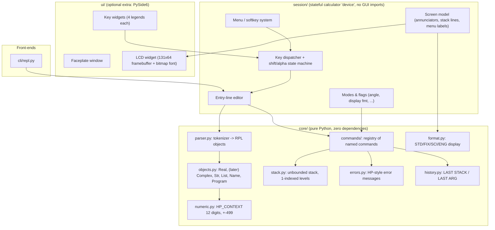

# Implementation Plan v2.1 — HP 48 RPN Calculator (Python, open source)

## Goal Description

Build a desktop RPN calculator that behaves like a classic **HP 48** (functional emulation, **not** Saturn/ROM hardware emulation) and *looks* like one (faithful faceplate + LCD), written mainly in Python, installable on your Mac, and maintainable by you for years. The project doubles as a hands-on SDLC/DevOps learning vehicle.

Success looks like:
1. You can double-click an app (or `uv run hp48`) and do real engineering calculations with an HP 48 feel.
2. Core logic is a **pure-Python library with zero third-party dependencies**, so it survives GUI-toolkit churn (answers your fear of abandonment).
3. Every behavior is traceable to a requirement and covered by an automated test; CI is green on every push.

---

## Review Log — what changed from v1 and why

| # | Finding in v1 | Why it matters | Fix in v2 |
|---|---|---|---|
| 1 | Used Python `float` | HP 48 uses **12-digit decimal** mantissa, exponent range ±499 (MINR `1E-499`, MAXR `9.99999999999E499`). `0.1+0.2` must give `.3`, not `0.30000000000000004`. A faithful calculator has to get this right from day one — retrofitting is painful. | Core numeric type built on `decimal.Decimal` with a fixed `HP_CONTEXT` (ADR-002). |
| 2 | Manual test expected `7.0` | HP 48 displays real `7` as **`7.`** (trailing point); integers-valued reals vs. binary integers (`#7h`) are distinct types. | Display formatter is its own module with STD/FIX/SCI/ENG modes; tests assert HP-style strings. |
| 3 | No "entry line" concept | On a real HP 48, typing builds a **command line**; `ENTER` parses it; pressing an operation with a non-empty line auto-`ENTER`s first. This is session logic, not stack logic. | New `session` layer owning the entry-line editor, modes and key dispatch. |
| 4 | Parser conflated with commands | RPL has objects (reals, complex, strings, lists, names, programs) and a tokenizer for them. | Separate `objects`, `parser`, `commands` modules; object model is extensible without touching the stack. |
| 5 | `pyproject.toml` had no `[build-system]` | With a `src/` layout and a `[project.scripts]` entry, `uv run hp48` would fail to install the package. | Add `uv_build` backend (ADR-001). |
| 6 | PySide6 added as a dependency in Sprint 1 | Pulls ~hundreds of MB before any GUI exists and slows CI. | GUI is an **optional extra** (`hp48[gui]`) added in Sprint 2. Core/CLI install stays dependency-free. |
| 7 | "Sprint 1" bundled scaffolding + CI + engine + REPL | Too big for a part-time maintainer; risk of no working artifact for long time. | **Sprint 0 = walking skeleton** (`3 ENTER 4 +` working end-to-end in a REPL with CI green). Engine depth follows in Sprint 1. |
| 8 | LCD described as a "4-line text widget" | The real LCD is a **131×64 monochrome pixel** matrix. Faithful look + future `GRAPH` support both want a pixel framebuffer with a bitmap font, scaled up. | LCD rendered from a framebuffer model (ADR-004), validated by a UI spike at start of Sprint 2. |
| 9 | Keyboard treated as a flat list | Each of the 49 keys has up to 4 legends (white, left-shift orange, right-shift blue, alpha) and layout differs slightly between **S-series (48S/SX)** and **G-series (48G/GX/G+)**. | Keyboard defined as **data** (`keymap.toml`); target is the **G-series / 48GX** (confirmed). |
| 10 | SDLC artifacts missing | You asked to be guided through the SDLC. | Add product brief, requirements w/ acceptance criteria, ADRs, Definition of Done, branching/PR flow, SemVer releases (see *SDLC Operating Model*). |
| 11 | No legal/IP note | HP trademarks/logo/ROM are HP's; project is now going open source. | Full risk map, clean-room rules, Apache-2.0 + DCO, product-name advice (see *Open Source Strategy & HP Issues*). |
| 12 | Only unit tests | Stack/number code has huge input spaces. | Add **property-based tests** (Hypothesis), golden tests from the HP 48 manuals, coverage gate, `mypy`. |

---

## User Review Required

> [!IMPORTANT]
> **Decision A — Numerics: `decimal.Decimal` (12 digits, ±499) instead of `float`.**
> Faithful and testable, a bit slower (irrelevant for a calculator). Transcendentals (`SIN`, `LN`, `EXP`…) are not in `decimal`; in Sprint 3 we compute them via high-precision evaluation and round to 12 digits, with exact special cases (e.g. `SIN(180)` in DEG = `0`). Options to evaluate then: pure-stdlib series vs. adding `mpmath`. This is deferred and recorded as an ADR.

> [!IMPORTANT]
> **Decision B — GUI toolkit: PySide6 (Qt), optional extra, introduced in Sprint 2.**
> | Option | Fidelity (custom keys, pixel LCD) | Packaging size | Long-term support | Verdict |
> |---|---|---|---|---|
> | **PySide6** | Excellent (QPainter, antialiasing control, high-DPI) | Large (100–300 MB app) | Official Qt for Python project | **Recommended** |
> | Tkinter | Adequate; clunky for custom-drawn keys, weak HiDPI on macOS | Tiny, stdlib | Ships with Python | Fallback |
> | pygame | Great for pixel LCD, poor for desktop-app feel | Medium | Community | Not recommended |
> Mitigation for abandonment risk: `uv.lock` pins versions; UI is a thin layer over the core, so a toolkit swap never touches calculation logic.

> [!WARNING]
> **Decision C — Scope discipline.** The HP 48 has ~2,000 commands (RPL programming, graphics, I/O, SD cards, equation library…). We will **not** chase parity. Increments are ordered by value to a petroleum/production engineer (units, matrices, solver-style workflows come before graphics or I/O). Each increment is releasable.

---

## Confirmed Decisions (v2.1, from your last message)

| Topic | Decision |
|---|---|
| Model | **HP 48GX (confirmed).** The 48G/48G+ share its keyboard and command set, so they come along for free. The older S-series (48S/SX) is out of scope. |
| Behavioral oracle | **iHP48 on your iPhone** — used **only to observe behavior by hand** and record expected results as test cases. See guardrails below. |
| Licence | **Apache-2.0 (confirmed)**, with DCO sign-off on commits. |
| Distribution | macOS (Apple Silicon) first; Windows/Linux through CI builds later. |
| Keyboard ergonomics | Physical keyboard mapping in addition to mouse (assumed yes). |
| Manuals | You will drop the HP 48G User's Guide / Advanced User's Reference Manual PDFs into `docs/` later. They are copyrighted, so `.gitignore` will exclude them (`docs/*.pdf`, `docs/reference/`) and CI/contributors never see them. Until they arrive, unverified behaviors are tagged `unverified` and checked in iHP48. |
| Working name | **`hp48-flix`** — distribution name `hp48-flix`, import package `hp48_flix`, command `hp48-flix`. Every `hp48` / `src/hp48/` path in this plan therefore reads `hp48_flix` / `src/hp48_flix/`. It still contains "hp48", so treat it as a **working name only**; pick a name without HP trademarks before the first public announcement (renaming now is cheap, later it is not). |

> [!NOTE]
> **Still open:** the licence choice only. Everything else is settled.

---

## Open Source Strategy & HP Issues (advice)

> [!CAUTION]
> I am not a lawyer; this is engineering-practice guidance. If this ever becomes commercial or you receive a notice, consult an IP attorney.

### 1. Is there a problem with HP? — Risk map

| Area | Risk | Why | What we do |
|---|---|---|---|
| **Our code (clean-room Python reimplementation)** | **Low** | Functional behavior/algorithms and command names are not copyrightable in the same way as code; HP's copyright covers its ROM *code*, not the idea of an RPN calculator. Projects like newRPL and Free42 follow this route. | Write our own code from documented behavior and black-box observation. |
| **HP ROM images** | **High if bundled** | The HP 48 ROM is HP-copyrighted. HP has historically tolerated hobbyist emulation (e.g. hpcalc.org hosting), but that is *non-enforcement*, not a licence. | **Never ship, copy, embed or require an HP ROM.** We don't emulate hardware, so we don't need one. |
| **Reading/decompiling the ROM to copy its logic** | **High** | Would taint our code and break the clean-room claim. | **Prohibited by CONTRIBUTING.md.** No disassembly output, no ROM-derived tables or strings in PRs. |
| **GPL code (Emu48, x48, Free42 …)** | **High for licence contamination** | Copying GPL code into an Apache-2.0 project is incompatible. | No code copied/translated from GPL projects; contributors certify originality (DCO). Ideas/behaviors OK; code not. |
| **Trademarks** ("HP", "HP 48", HP logo) | **Medium** | Using the name/logo as *our product identity* or implying endorsement can draw a takedown. Descriptive reference ("compatible with HP 48 behavior") is generally fine. | Product name that doesn't start with/contain "HP"; README disclaimer: *"Not affiliated with or endorsed by HP Inc."*; no HP logo or "HEWLETT·PACKARD" badge. |
| **Trade dress / artwork** (faceplate artwork, logos, fonts) | **Medium** | Pixel-perfect copies of HP's artwork/logo or scanned manual images are copyrightable; the 49-key *layout and legends* are functional. | Draw our **own** faceplate artwork inspired by the layout; own keycap graphics; freely-licensed fonts (e.g. SIL OFL) for the LCD font, **not** bitmaps extracted from the ROM. |
| **Manuals** | **Medium** | PDF manuals are copyrighted. | Don't commit/redistribute; cite section names only; paraphrase in our docs. |
| **iHP48 usage** | **Low** if used as a black-box oracle | Observing outputs for your own test expectations is fine. The app and the ROM inside have their own terms. | Don't extract ROM/assets from the app; record **only input → output pairs** in tests (`tests/golden/*.yaml`), noting "observed on HP 48GX firmware via emulator". |

**Bottom line:** a clean-room, ROM-free, own-artwork, differently-branded Apache-2.0 project is a well-trodden path (newRPL, Free42, DB48X) and low risk. The things that cause trouble are bundling ROMs, copying HP assets/logos, and borrowing GPL code.

### 2. Licence choice — Apache-2.0 (recommended) vs MIT

| | MIT | **Apache-2.0** |
|---|---|---|
| Simplicity | Shortest | Longer but standard |
| Patent grant | None | **Explicit** (protects you & users) |
| Contributions | Implicit | **Explicit contribution licence (Sec. 5)** — ideal for community PRs |
| Trademark | Silent | **Explicitly grants no trademark rights** — useful given HP concerns |
| Compatibility | Very high | High (one-way compatible with GPLv3; not GPLv2-only) |

Recommendation: **Apache-2.0** + **DCO** (`Signed-off-by` on commits, enforced by a CI check) instead of a heavy CLA. MIT would also be fine if you prefer simplicity — say the word.

### 3. Making it contribution-ready (added to Sprint 0)
`LICENSE` (Apache-2.0), `NOTICE`, `README.md` (+ non-affiliation disclaimer), `CONTRIBUTING.md` (clean-room rules, DCO, dev setup with `uv`, how to add a command, how to add a golden test), `CODE_OF_CONDUCT.md` (Contributor Covenant), `SECURITY.md`, issue templates (bug / "behavior differs from HP 48" / feature), PR template with Definition-of-Done checklist, `good first issue` labels (e.g. "implement command X + tests"), GitHub Discussions, CODEOWNERS, branch protection on `main` (PR + green CI + DCO). The **command registry** design makes "add one command" a small, well-bounded first contribution.

### 4. How iHP48 is used as an oracle (guardrails)
1. For each feature, you run the keystrokes on iHP48 and note **inputs, mode/flag settings, and displayed result**.
2. We encode them as golden cases, e.g. `tests/golden/stack_ops.yaml`, with `source: iHP48 (HP 48GX)`.
3. Where iHP48 and the manual disagree, the test is tagged `observed` and the discrepancy is documented.
4. No screenshots of ROM-rendered screens are committed unless you're comfortable with the IP risk; text transcriptions are enough.

---

## Architecture



Dependency rule (enforced by an import-linter test): `core` imports nothing from `session`/`ui`/`cli`; `session` imports nothing from `ui`.

### Key design snippets

**Numeric context (ADR-002)**
```python
# src/hp48/core/numeric.py
from decimal import Context, Decimal, ROUND_HALF_EVEN, Inexact, Rounded

# 12-digit mantissa, exponent range +-499, per HP 48 real number spec.
# Rounding mode to be validated against golden tests from the manuals.
HP_CONTEXT = Context(prec=12, Emin=-499, Emax=499, rounding=ROUND_HALF_EVEN, traps=[])

MAXR = Decimal("9.99999999999E499")
MINR = Decimal("1E-499")
```

**Object model (extensible)**
```python
# src/hp48/core/objects.py
from dataclasses import dataclass
from decimal import Decimal

class RplObject: ...

@dataclass(frozen=True)
class Real(RplObject):
    value: Decimal
```

**Keyboard as data (ADR-003)**
```toml
# src/hp48/session/keymaps/hp48gx.toml  (illustrative)
[[key]]
id = "R1C1"            # row, column
primary = "A"          # softkey F1 (menu-driven)
left_shift = "MTH"     # orange
right_shift = "..."    # blue
alpha = "A"
```

**Error fidelity**
```python
# src/hp48/core/errors.py
class Hp48Error(Exception):
    """User-visible error; .message mirrors the HP 48 wording (e.g. 'Too Few Arguments')."""
```
Exact messages (`Too Few Arguments`, `Bad Argument Type`, `Bad Argument Value`, divide-by-zero behavior controlled by flag -22) will be confirmed against the Advanced User's Reference before being locked into tests.

---

## SDLC Operating Model (what we create and how we work)

| SDLC phase | Artifact / practice | Where |
|---|---|---|
| Plan | One-page **Product Brief** (vision, users, non-goals) | `docs/product-brief.md` |
| Requirements | User stories with acceptance criteria, MoSCoW priority, IDs like `REQ-STK-003` | `docs/requirements.md` + GitHub Issues/Milestones (one milestone per increment) |
| Design | **ADRs** (short decision records): build backend, numerics, keymap-as-data, GUI toolkit, LCD framebuffer | `docs/adr/NNN-*.md` |
| Build | Trunk-based with short-lived feature branches → PR → CI → squash-merge; Conventional Commits | GitHub |
| Test | Unit + property (Hypothesis) + golden tests from manuals; tests reference `REQ-` IDs in docstrings (lightweight traceability) | `tests/` |
| Release | SemVer tags (`v0.1.0` = Sprint 1 done), GitHub Releases with notes | GitHub Actions |
| Operate/Maintain | Dependabot weekly, `uv.lock` committed, changelog | `.github/` |

**Definition of Done (per story):** code + tests + `ruff` + `mypy` clean + docs/ADR updated + requirement ID traced + CI green + manual check recorded in PR.

---

## Increments

| Increment | Theme | Outcome (demoable) |
|---|---|---|
| **Sprint 0** | Foundations & walking skeleton | Repo hygiene, CI green, `uv run hp48` REPL: `3 ENTER 4 +` → `7.` |
| **Sprint 1** | Core engine v1 | Stack ops, entry-line semantics, arithmetic, STD/FIX/SCI/ENG formatting, LAST ARG/UNDO, HP-style errors; ≥90% core coverage |
| **Sprint 2** | Faceplate GUI | LCD framebuffer + 49-key faceplate driving the same session; shifts/alpha state machine; keyboard mapping. Starts with a 1-day **UI spike** to validate LCD rendering approach |
| **Sprint 3** | Math & menus | Trig with DEG/RAD/GRAD, logs/exponentials, `MTH` menu tree, softkey menus, constants, percent functions |
| **Sprint 4** | Objects | Complex, vectors/matrices, lists, strings, global variables (`STO`/`RCL`/`VAR` menu), algebraic `' '` entry, basic programs `« »` |
| **Sprint 5** | Engineer's toolkit & ship | Units (`15_m3/d`, `CONVERT`), persistence, `.app` bundle via PyInstaller, GitHub Release workflow |

---

## Proposed Changes (Sprint 0 + Sprint 1 only; later increments get their own plan)

### Build system & tooling

#### [MODIFY] pyproject.toml
```toml
[project]
name = "hp48-flix"                 # working name; rename before public launch (see IP advice)
version = "0.1.0"
description = "Faithful functional HP 48 RPN calculator in Python (unofficial, clean-room)"
readme = "README.md"
license = "Apache-2.0"
license-files = ["LICENSE", "NOTICE"]
requires-python = ">=3.13"
dependencies = []

[project.scripts]
hp48-flix = "hp48_flix.__main__:main"

[dependency-groups]
dev = ["pytest", "pytest-cov", "hypothesis", "ruff", "mypy", "import-linter"]

[build-system]
requires = ["uv_build>=0.11.7,<0.12"]
build-backend = "uv_build"

[tool.ruff]
line-length = 100
[tool.ruff.lint]
select = ["E", "F", "I", "B", "UP", "SIM", "N"]

[tool.pytest.ini_options]
testpaths = ["tests"]
addopts = "--cov=hp48_flix --cov-report=term-missing"

[tool.mypy]
strict = true
files = ["src"]
```
(The GUI extra `hp48[gui]` is added in Sprint 2 via `uv add --optional gui pyside6`.)

#### [DELETE] main.py
Replaced by the packaged entry point `src/hp48/__main__.py`.

#### [MODIFY] README.md
Project vision, install/run instructions, architecture diagram, status badge.

#### [NEW] .gitignore, CHANGELOG.md
`.venv/`, `__pycache__/`, `.coverage`, `docs/*.pdf` and `docs/reference/` (your copyrighted HP manuals), `dist/`.

#### [NEW] Open-source governance files (repo root)
| File | Purpose |
|---|---|
| `LICENSE`, `NOTICE` | Apache-2.0 text; NOTICE with copyright holder and "not affiliated with HP Inc." line |
| `CONTRIBUTING.md` | Dev setup (`uv sync`), clean-room rules (**no ROM, no disassembly, no GPL code, no HP artwork**), DCO sign-off (`git commit -s`), how to add a command, how to add a golden test, PR checklist |
| `CODE_OF_CONDUCT.md` | Contributor Covenant 2.1 |
| `SECURITY.md` | Private vulnerability reporting via GitHub |
| `.github/ISSUE_TEMPLATE/{bug,behavior-differs-from-hp48,feature}.yml` | The "behavior differs" template asks for keystrokes, flags/mode, expected vs actual (and where expected came from) |
| `.github/pull_request_template.md` | Definition-of-Done checklist + originality/clean-room attestation |
| `.github/CODEOWNERS` | You as default reviewer |
| `docs/legal.md` | Plain-language statement of clean-room policy, trademarks, ROM stance |
| GitHub settings (manual, I'll give you the click-path) | Branch protection on `main` (PR + CI + DCO), Discussions on, labels (`good first issue`, `help wanted`, `command`, `golden-test`), DCO app installed |


#### [NEW] .github/workflows/ci.yml
```yaml
name: CI
on: [push, pull_request]
jobs:
  test:
    strategy:
      matrix:
        os: [ubuntu-latest, macos-latest]
        python: ["3.13", "3.14"]
    runs-on: ${{ matrix.os }}
    steps:
      - uses: actions/checkout@v4
      - uses: astral-sh/setup-uv@v5
      - run: uv python install ${{ matrix.python }}
      - run: uv sync --python ${{ matrix.python }}
      - run: uv run ruff check .
      - run: uv run ruff format --check .
      - run: uv run mypy
      - run: uv run lint-imports
      - run: uv run pytest
```

#### [NEW] .github/dependabot.yml
Weekly updates for `pip`/`uv` and `github-actions`.

---

### Documentation (SDLC artifacts)

#### [NEW] docs/product-brief.md, docs/requirements.md, docs/adr/001–004
ADR-001 build backend (`uv_build`, src layout) · ADR-002 numerics (Decimal 12 digits) · ADR-003 keyboard as data & model selection · ADR-004 LCD as 131×64 framebuffer (status: *proposed*, finalized after Sprint 2 spike).

---

### Core library — `src/hp48/core/`

#### [NEW] numeric.py — `HP_CONTEXT`, `MAXR`, `MINR`, rounding/overflow helpers.
#### [NEW] objects.py — `RplObject`, `Real` (others later).
#### [NEW] stack.py — unbounded stack, level 1 = top; `push/pop/peek(n)/depth`, `DROP DUP SWAP OVER ROT ROLL ROLLD PICK DEPTH CLEAR DUP2 DROP2 DUPN DROPN`; `Too Few Arguments` on underflow.
#### [NEW] parser.py — tokenize numbers (`12`, `-3.5`, `1.2E-4`, `.5`) and command names; later extended for `' '`, `« »`, `{ }`, `" "`, `(x,y)`, `[ ]`.
#### [NEW] commands/ — registry (`@command("+")`) + arithmetic (`+ - * / ^ NEG INV SQ SQRT ABS`), stack ops, constants `MAXR MINR`.
#### [NEW] format.py — STD/FIX/SCI/ENG formatting (`7.`, `.3`, `1.5E-3`, …).
#### [NEW] history.py — snapshot for `LAST STACK` (UNDO) and `LAST ARG`.
#### [NEW] errors.py — `Hp48Error` hierarchy with HP wording.

### Session — `src/hp48/session/`

#### [NEW] entry.py — entry-line editor (digit/`.`/`EEX`/`+/-`/backspace/`ENTER`, auto-ENTER on operation).
#### [NEW] calculator.py — `Calculator` object: stack + modes + entry line; `press(text)`/`execute(cmd)`; exposes read-only `screen_model()` for any front-end.

### CLI — `src/hp48/cli/repl.py`, `src/hp48/__main__.py`
REPL shows 4 stack levels in HP style (`4:`, `3:`, `2:`, `1:`), accepts space-separated tokens, prints HP-style errors without crashing.

### Tests — `tests/`
- `test_numeric.py` — 12-digit rounding, overflow to MAXR/error, `0.1+0.2 == .3`.
- `test_stack.py` — all stack ops incl. underflow; **Hypothesis** properties (e.g. `SWAP SWAP` identity, `DUP DROP` identity, `ROLL`/`ROLLD` inverse).
- `test_parser.py`, `test_format.py` (parameterized golden tables), `test_commands_arith.py`, `test_entry.py`, `test_history.py`, `test_calculator_scenarios.py` (end-to-end keystroke scripts).
- `test_architecture.py` / import-linter contract: layering rules.
- `test_golden.py` + `tests/golden/*.yaml` — data-driven cases, each with `keys`, `flags`, `expect_stack`, `source` (`manual` | `observed:iHP48`) and `req` ID. Community members can contribute a case **without writing Python**.

---

## Risks & Mitigations

| Risk | Mitigation |
|---|---|
| Scope explosion (2,000 commands) | Increment plan, MoSCoW, ship small releases |
| Behavior drift from real HP 48 | Golden tests from manuals + iHP48 observations (tagged by source) |
| Trig/log precision at 12 digits | Isolated in Sprint 3 with its own ADR and test tables |
| Qt/PySide churn or large bundles | Core stays dependency-free; UI thin; `uv.lock` pinning; Tkinter fallback documented |
| HP trademark/ROM/IP | See *Open Source Strategy & HP Issues*: clean-room, **no ROM**, own artwork, non-HP product name, non-affiliation disclaimer, Apache-2.0 (no trademark grant) |
| Licence contamination via contributions | DCO sign-off, PR originality attestation, CONTRIBUTING clean-room rules, reviewer checks for suspicious ROM/GPL-derived content |
| Takedown/complaint received | `docs/legal.md` response plan: respond politely, rename/replace flagged asset quickly (assets isolated in `ui/assets/` to make this easy) |
| Community expectations vs. solo maintainer capacity | Clear roadmap, `good first issue` backlog, contribution guide, "best-effort maintenance" statement in README |
| Solo part-time burnout | Walking skeleton first; each increment independently useful |
| Python version drift | CI matrix 3.13 & 3.14; `.python-version` stays 3.13 |

---

## Verification Plan

### Automated Tests
```bash
uv sync
uv run ruff check . && uv run ruff format --check .
uv run mypy
uv run lint-imports
uv run pytest -v          # includes coverage report; gate: >= 90% on src/hp48/core
```
CI runs the same on macOS + Ubuntu with Python 3.13 and 3.14.

### Manual Verification
```bash
uv run hp48-flix
```
1. `3 ENTER 4 +` → level 1 shows `7.`
2. `.1 .2 +` → `.3`
3. `12 3 /` → `4.`
4. `1 0 /` → HP-style error (exact wording per Advanced User's Reference), stack unchanged.
5. `1 2 3 ROT` → levels read `1:1 2:3 3:2`; `SWAP`, `DUP`, `DROP`, `CLEAR`, `DEPTH` behave as in the manual.
6. `5 ENTER 6 ENTER 7 + ` then `LAST STACK` restores the previous stack.
7. `9.99999999999E499 10 *` → overflow handled per HP rules.

---

## Next step
On approval I will execute **Sprint 0 first** (tooling, CI, docs skeleton, walking-skeleton REPL), stop for your review, then proceed to Sprint 1.
